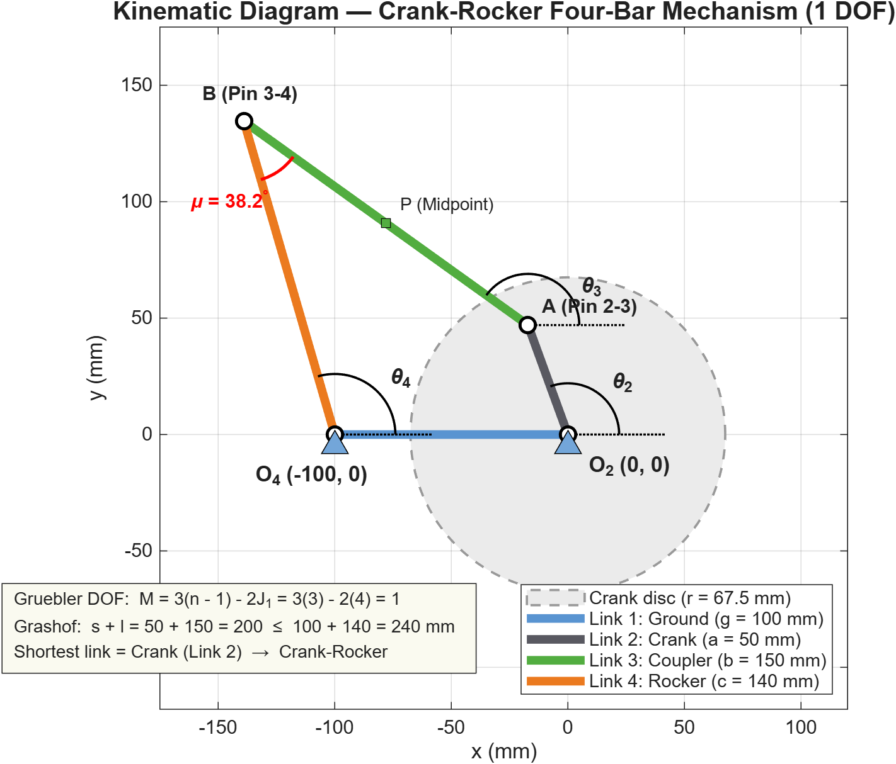
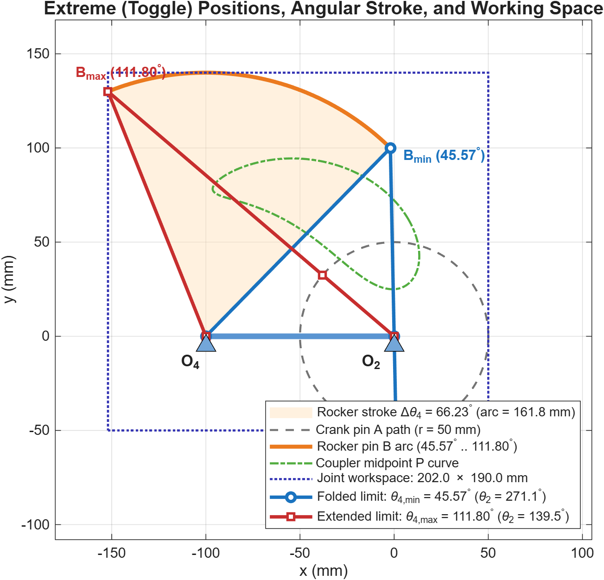
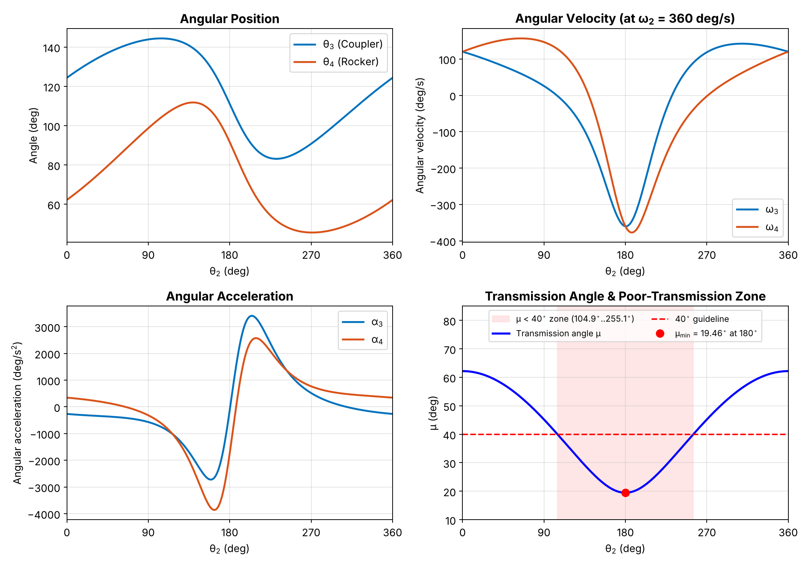
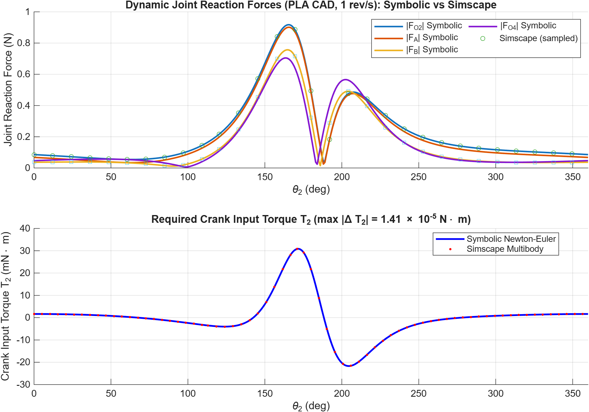
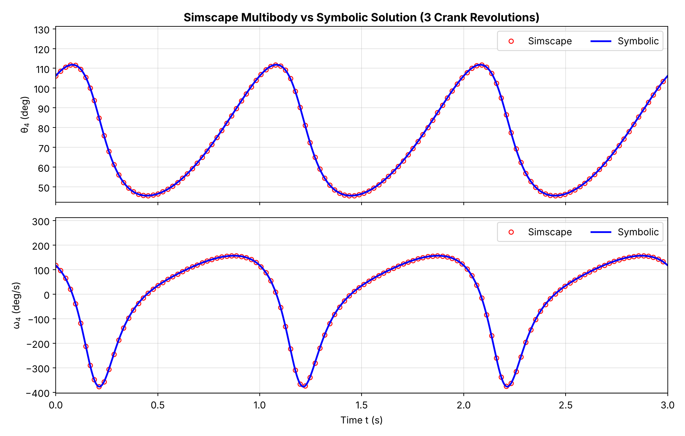
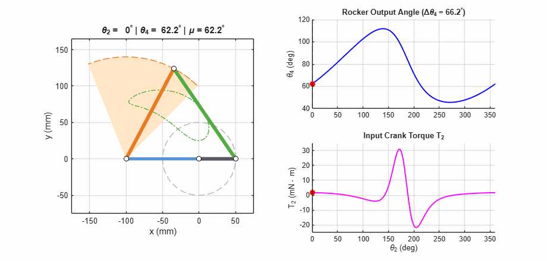
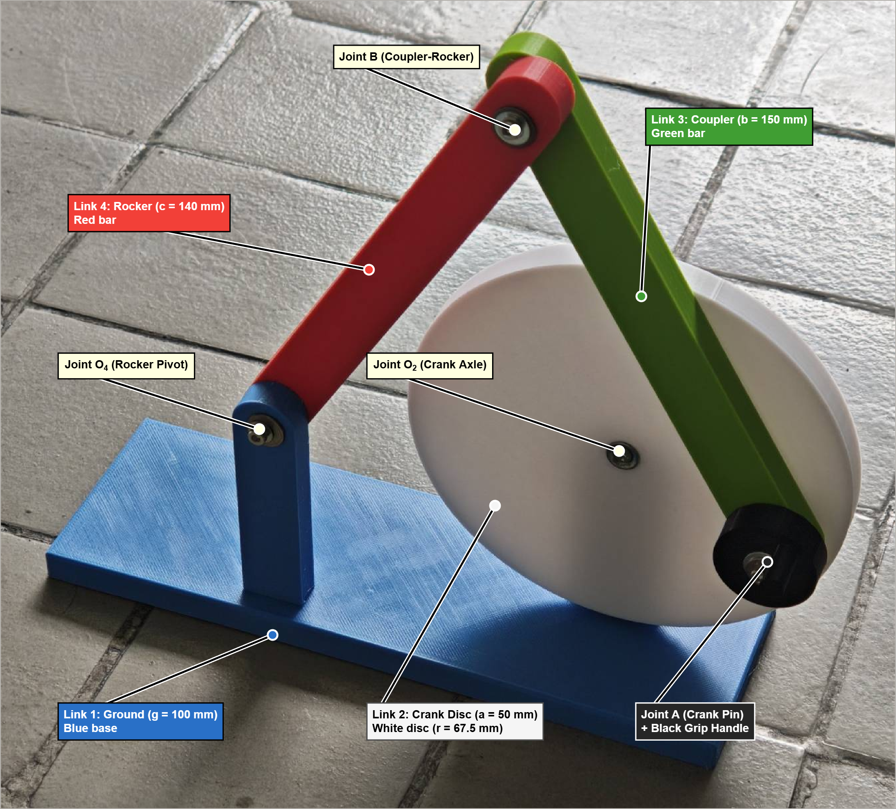

# Crank–Rocker Four-Bar Mechanism

Term project for **2103-322 Design of Mechanism (Mech Machinery)** — kinematic synthesis/analysis, symbolic dynamic force analysis, Simscape Multibody CAD simulation, and a 3D-printed physical prototype of a planar **Crank–Rocker four-bar linkage**.

---

## Project Overview

- **Mechanism Type:** Planar Four-Bar Linkage — **Crank–Rocker** (Grashof Class I, shortest link = crank)
- **Primary Function:** Converts **continuous 360° rotary motion** of the input crank disc (Link 2, $a = 50\text{ mm}$) into **bounded oscillating angular motion** of the output rocker (Link 4, $c = 140\text{ mm}$), operating as a **function generator** $\theta_4 = f(\theta_2)$ with a **quick-return** stroke ratio ($TR = 1.734$).
- **Material & Fabrication:** 3D-printed PLA ($\rho = 1240\text{ kg/m}^3$), Fusion 360 CAD (`hardware/mechanical/Crank-Rocker_final.f3z`).
- **Group Members:**
  - Pariyakorn Silakorn (`rovskysarami@gmail.com`)
  - Thanakit Chansiri (`ninekickoff@gmail.com`)
  - Nataporn Luksiri (`nataporn18092549@gmail.com`)

### Repository Structure

| Path | Description |
|---|---|
| [`RUN_ME.m`](RUN_ME.m) | One-click MATLAB runner for Simscape simulation, symbolic analysis, and real-time dashboard |
| [`hardware/mechanical/`](hardware/mechanical/) | Fusion 360 source (`.f3z`) and exported CAD `.step` parts & assembly |
| [`simulation/symbolic/`](simulation/symbolic/) | Symbolic Math Toolbox derivation (`fourbar_symbolic.m`), interactive dashboard (`fourbar_realtime.m`), tables & equations |
| [`simulation/multibody/`](simulation/multibody/) | Simscape Multibody builder (`fourbar_cad_v2.m`), Simulink model (`fourbar_v2_model.slx`), and simulation logs |
| [`media/`](media/) | Kinematic diagram, extreme positions, analysis plots, animation (`.gif`, `.avi`), and physical model photo |

---

## Part I: Basics — Kinematic Diagram, DOF, Extreme Positions & Working Space

### 1.1 Link & Joint Identification

Origin is placed at the crank disc axle $O_2 = (0, 0)\text{ mm}$, and the rocker pivot is at $O_4 = (-100, 0)\text{ mm}$. All link angles are measured counter-clockwise from the $+x$ axis.

| Link | Part / Colour in CAD | Pin-to-Pin Length | Mass (PLA, CAD) | Role / Function |
|:---:|---|---:|---:|---|
| **1** | Ground (`cr2_ground.step`, light blue) | $g = 100\text{ mm}$ | Fixed | Fixed frame supporting pivots $O_2$ and $O_4$ |
| **2** | Crank Disc (`cr2_link4.step`, grey) | $a = 50\text{ mm}$ (disc $r = 67.5\text{ mm}$) | $176.19\text{ g}$ | Continuous rotary input ($\theta_2$ at $\omega_2 = 1\text{ rev/s}$) |
| **3** | Coupler (`cr2_link3.step`, green) | $b = 150\text{ mm}$ | $42.05\text{ g}$ | Transmits motion from crank pin $A$ to rocker pin $B$ |
| **4** | Rocker (`cr2_link2.step`, orange/red) | $c = 140\text{ mm}$ | $39.57\text{ g}$ | Oscillating output link ($\theta_4$) |
| *Grip* | Handle (`cr2_handle.step`, black) | Mounted on pin $A$ ($J_5$) | $8.84\text{ g}$ | Free-turning manual grip held upright by hand |

The core four-bar linkage contains **4 revolute joints** ($O_2, A, B, O_4$).

### 1.2 Degrees of Freedom (DOF) & Grashof Check

Using the planar **Grübler–Kutzbach equation**:

$$
M = 3(n - 1) - 2J_1 - J_2
$$

where $n = 4$ links, $J_1 = 4$ revolute (1-DOF) joints, and $J_2 = 0$ higher pairs:

$$
M = 3(4 - 1) - 2(4) - 0 = \boxed{1\text{ DOF}}
$$

*(The free-turning handle on pin $A$ adds one auxiliary local rotation $J_5$ that does not affect the four-bar kinematic loop.)*

**Grashof Condition:**

$$
s + l = 50 + 150 = 200\text{ mm} \le p + q = 100 + 140 = 240\text{ mm}
$$

Because $s + l < p + q$ and the **shortest link** ($a = 50\text{ mm}$) is the **crank** adjacent to the ground, the mechanism is guaranteed to be a **Crank–Rocker** with full $360^\circ$ crank rotation.

### 1.3 Extreme Positions, Angular Stroke & Working Space

The rocker reaches its two **toggle (dead-center) extreme positions** when the crank and coupler become collinear ($|O_2 B| = b \pm a$):

| Parameter | Value | Configuration / Notes |
|---|---:|---|
| **Folded Extreme Position ($\theta_{4,\min}$)** | **$45.573^\circ$** | Occurs at $\theta_2 = 271.15^\circ$ ($|O_2 B| = b - a = 100\text{ mm}$) |
| **Extended Extreme Position ($\theta_{4,\max}$)** | **$111.804^\circ$** | Occurs at $\theta_2 = 139.46^\circ$ ($|O_2 B| = b + a = 200\text{ mm}$) |
| **Output Angular Stroke ($\Delta\theta_4$)** | **$66.231^\circ$** | Arc travel at rocker pin $B$: $s_B = c\,\Delta\theta_4 = 161.83\text{ mm}$ |
| **Time Ratio ($TR$, Quick-Return)** | **$1.7339$** | Slow forward swing ($228.32^\circ$) vs. fast return ($131.68^\circ$ of crank) |
| **Joint Working Space** | **$202.0 \times 190.0\text{ mm}$** | $x \in [-152.00, 50.00]\text{ mm}$, $y \in [-50.00, 140.00]\text{ mm}$ (fits within A4 $297 \times 210\text{ mm}$) |

### 1.4 Transmission Quality & Limitations Analysis ($\mu < 40^\circ$ Zone)

Unlike an ideal constant-transmission linkage, a compact quick-return crank–rocker experiences varying **transmission angle $\mu$** (angle between coupler $AB$ and rocker $O_4 B$):

- **$\mu_{\max} = 62.182^\circ$** at $\theta_2 = 0^\circ$ (good force transmission)
- **$\mu_{\min} = 19.463^\circ$** at $\theta_2 = 180^\circ$ (minimum distance $|A O_4| = g - a = 50\text{ mm}$)
- **Poor-transmission interval ($\mu < 40^\circ$):** occurs for **$\theta_2 \in [104.92^\circ, 255.08^\circ]$** (spanning the fast return stroke).
- **Engineering impact:** Because transmitted tangential force scales with $\sin\mu$ while joint bearing load scales with $1/\sin\mu$, operating near $\theta_2 = 180^\circ$ ($\sin 19.46^\circ \approx 0.333$) triples the normal bearing reaction required per unit output torque and coincides with peak rocker deceleration/acceleration ($\alpha_{4,\text{peak}} = -67.3\text{ rad/s}^2$, $|F_{O_2}|_{\text{peak}} = 0.917\text{ N}$). In the physical PLA prototype, keeping friction low at pins $A$ and $B$ is therefore essential through this sector.

---

## Part II: Symbolic Math (Position, Velocity, Acceleration & Dynamic Forces)

All equations were derived symbolically using MATLAB's **Symbolic Math Toolbox** in [`simulation/symbolic/fourbar_symbolic.m`](simulation/symbolic/fourbar_symbolic.m) (see exported equations in [`fourbar_symbolic_equations.txt`](simulation/symbolic/fourbar_symbolic_equations.txt) and $1^\circ$ resolution table in [`fourbar_symbolic_table.csv`](simulation/symbolic/fourbar_symbolic_table.csv)).

- **Vector-Loop Closure & Freudenstein Equation:**

$$
a\cos\theta_2 + b\cos\theta_3 = -g + c\cos\theta_4, \qquad a\sin\theta_2 + b\sin\theta_3 = c\sin\theta_4
$$

$$
P\cos\theta_4 + Q\sin\theta_4 + R = 0
$$

where $P = -2c(g + a\cos\theta_2)$, $Q = -2ac\sin\theta_2$, and $R = a^2 - b^2 + c^2 + g^2 + 2ag\cos\theta_2$. Solving via tangent half-angle substitution $t = \tan(\theta_4/2)$ selects **Circuit 1** (matching the Fusion 360 assembly pose $\theta_2 = 110.08^\circ, \theta_4 = 106.18^\circ$).

- **Velocity & Acceleration (Jacobian Differentiation):**

$$
\omega_3 = -\frac{a\omega_2 \sin(\theta_2 - \theta_4)}{b\sin(\theta_3 - \theta_4)}, \qquad \omega_4 = -\frac{a\omega_2 \sin(\theta_2 - \theta_3)}{c\sin(\theta_3 - \theta_4)}
$$

and $(\alpha_3, \alpha_4)$ follow from $\frac{d}{dt}[\omega_3; \omega_4]$ at constant crank speed $\omega_2 = 2\pi\text{ rad/s}$ ($1\text{ rev/s}$ CCW, $\alpha_2 = 0$).

- **Dynamic Force & Input Torque Analysis (Planar Newton–Euler $9\times 9$ System):**

Using the exact PLA CAD link masses, CoM positions, and $I_{zz}$ inertias (including pin $A$, pin $B$, and handle mass), the 9 planar rigid-body equilibrium equations for Links 2, 3, and 4 are assembled symbolically via `equationsToMatrix`:

$$
A_F(\theta_2, \theta_3, \theta_4)\,\mathbf{x}_F = \mathbf{b}_F(\theta_2, \theta_3, \theta_4, \omega_3, \omega_4, \alpha_3, \alpha_4)
$$

where $\mathbf{x}_F = [F_{12x}, F_{12y}, F_{32x}, F_{32y}, F_{43x}, F_{43y}, F_{14x}, F_{14y}, T_2]^T$.

| Quantity (at $\omega_2 = 1\text{ rev/s}$, PLA CAD) | Peak / Range |
|---|---|
| Rocker angular velocity $\omega_4$ | $-6.605 \dots +2.728\text{ rad/s}$ |
| Rocker angular acceleration $\alpha_4$ | $-67.33 \dots +44.86\text{ rad/s}^2$ |
| Crank axle reaction force $\|F_{O_2}\|$ | $\max 0.9174\text{ N}$ |
| Crank–coupler pin force $\|F_A\|$ | $\max 0.9012\text{ N}$ |
| Coupler–rocker pin force $\|F_B\|$ | $\max 0.7569\text{ N}$ |
| Rocker pivot force $\|F_{O_4}\|$ | $\max 0.7045\text{ N}$ |
| Input crank torque $T_2$ | $-21.69 \dots +30.87\text{ mN}\cdot\text{m}$ |

An interactive real-time dashboard with moving velocity/acceleration vectors is also included in [`simulation/symbolic/fourbar_realtime.m`](simulation/symbolic/fourbar_realtime.m).

---

## Part III: Simscape Multibody CAD Simulation

The real Fusion 360 `.step` parts (`cr2_ground.step`, `cr2_link4.step`, `cr2_handle.step`, `cr2_link3.step`, `cr2_link2.step`) are assembled programmatically in [`simulation/multibody/fourbar_cad_v2.m`](simulation/multibody/fourbar_cad_v2.m) into [`fourbar_v2_model.slx`](simulation/multibody/fourbar_v2_model.slx) with PLA density $\rho = 1240\text{ kg/m}^3$, closed-loop revolute joints $J_1 \dots J_4$, free-grip joint $J_5$, and force/torque sensing over 3 crank revolutions ($3\text{ s}$, `ode23t`).

### Verification: Symbolic vs. Simscape Multibody (3,125 steps)

| Metric | Max Absolute Difference |
|---|---:|
| Rocker angle $\theta_4$ | $1.18 \times 10^{-10}\text{ deg}$ |
| Rocker angular velocity $\omega_4$ | $4.99 \times 10^{-12}\text{ rad/s}$ |
| Crank input torque $T_2$ | $1.41 \times 10^{-5}\text{ N}\cdot\text{m}$ |
| Joint reaction forces ($\|F_{O_2}\|, \|F_A\|, \|F_B\|, \|F_{O_4}\|$) | $\le 1.75 \times 10^{-6}\text{ N}$ |

### Motion Animation

- Download full video: [`media/crank_rocker.avi`](media/crank_rocker.avi)
- Simulation table: [`simulation/multibody/fourbar_v2_results.csv`](simulation/multibody/fourbar_v2_results.csv)

---

## Part IV: Built Mechanism

| Variable | Link | Colour in Physical Prototype | Pin-to-Pin Length |
| :---: | :--- | :--- | :---: |
| **`g`** | **Link 1: Ground** | Blue base stand | $100\text{ mm}$ ($O_2$–$O_4$) |
| **`a`** | **Link 2: Crank Disc** | White disc (+ black grip handle on pin $A$) | $50\text{ mm}$ ($O_2$–$A$, disc $r = 67.5\text{ mm}$) |
| **`b`** | **Link 3: Coupler** | Green bar | $150\text{ mm}$ ($A$–$B$) |
| **`c`** | **Link 4: Rocker** | Red bar *(orange in Simscape)* | $140\text{ mm}$ ($O_4$–$B$) |

The physical prototype was 3D-printed in PLA matching the exact Fusion 360 CAD dimensions above and mounted on a rigid base within an A4 footprint. *(Original unlabeled photo: [`media/built_mechanism.jpg`](media/built_mechanism.jpg))*
